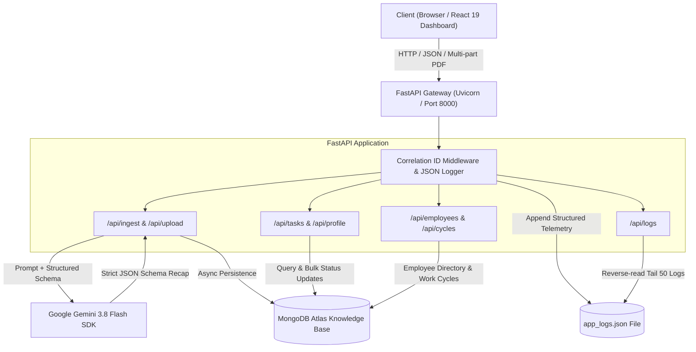

# DigiPlus Task Manager — AI Enterprise Intelligence Platform
*SPIT Assessment Submission | Fullstack Autonomous Task & Knowledge Management Platform*

[](https://fastapi.tiangolo.com)
[](https://react.dev/)
[](https://tailwindcss.com/)
[](https://ai.google.dev/)
[](https://www.mongodb.com/atlas)

---

## 1. Project Overview & Architecture

**DigiPlus Task Manager** is an enterprise-grade AI task extraction, meeting summarization, and team lifecycle management platform. Built to streamline engineering operations, it autonomously parses complex meeting transcripts, executive syncs, technical developer handoffs, and PDF documents into actionable task tickets, business decisions, and summaries.

### Architecture Overview
The platform is organized as a decoupled, modular client-server architecture:
- **Frontend (`frontend/`)**: Modern React 19 application built with Vite and Tailwind CSS. Features full-screen responsive layouts, interactive task lifecycle boards, employee roster management, work cycle iteration tracking, and instant summary file downloads.
- **Backend (`backend/`)**: Asynchronous FastAPI service organized into domain-specific routers (`ingest`, `tasks`, `team`, `logs`). It interfaces with MongoDB Atlas via Motor (`asyncio`) and Google Gemini AI via the Google GenAI SDK.
- **Database (`MongoDB Atlas`)**: Document-oriented data store managing unstructured text, nested structured action items, team member directory, and development lifecycles.



---

## 2. AI Configuration & Schema Enforcement

The platform leverages **Google Gemini 3.8 Flash** (`gemini-3.8-flash`) for low-latency, deterministic extraction of summaries, decisions, and action items from arbitrary text and PDF documents.

### Strict Pydantic Schema
To guarantee machine-readable JSON without hallucinated keys, generation is enforced via Pydantic models passed directly into the SDK's `GenerationConfig`:

```python
class ActionItem(BaseModel):
    description: str = Field(description="Clear description of the task")
    owner: str = Field(description="Name of the person assigned, or 'Unassigned'")
    due_date: str = Field(description="Deadline in YYYY-MM-DD format if mentioned, otherwise 'None'")
    status: str = Field(description="Current status: Open, In Progress, or Closed")

class StructuredRecap(BaseModel):
    summary: str = Field(description="A concise catch-up brief or developer handoff summary")
    decisions: List[str] = Field(description="List of key decisions made or technical choices")
    action_items: List[ActionItem] = Field(description="List of action items and tasks")
```

### Defensive Fallback Parsing
When analyzing text that contains no action items or architectural decisions, language models may occasionally omit those keys. To maintain 100% API reliability, the backend implements a dual-layer defense:
1. **Critical Prompt Directive**: The prompt explicitly enforces three mandatory root keys:
   > *"CRITICAL: You MUST return a JSON object containing exactly three keys: summary, decisions, and action_items. If there are no decisions or action items found in the text, you must return an empty array [] for those keys. Never omit the keys."*
2. **Defensive Pre-Validation Sanitizer**: Prior to `StructuredRecap.model_validate()`, the raw JSON payload is parsed into an in-memory dictionary. Any missing or `None` keys for `decisions` and `action_items` are normalized to empty lists `[]`, eliminating schema validation crashes.

---

## 3. Data Approach & MongoDB Knowledge Base Structure

All data is stored asynchronously using `Motor` (`AsyncIOMotorClient`) under the `digiplus_task_manager` database across four primary collections:

### 1. `knowledge_base`
Stores processed meeting notes, developer handoffs, and PDF summaries:
```json
{
  "_id": ObjectId("67222384a91b..."),
  "source_type": "meeting",
  "author": "Alex Morgan",
  "filename": "Q4_Architecture_Sync.pdf",
  "raw_text": "Executive Leadership & Sprint Alignment...",
  "summary": "Team aligned on migrating REST polling to WebSockets and finalizing PKCE authentication.",
  "decisions": [
    "Approved Q4 migration from REST polling to WebSockets",
    "Decided to adopt Tailwind CSS enterprise light design system"
  ],
  "action_items": [
    {
      "description": "Finalize OAuth2 PKCE token rotation",
      "owner": "Alice",
      "due_date": "2026-11-05",
      "status": "In Progress"
    },
    {
      "description": "Deliver responsive React dashboard",
      "owner": "Bob",
      "due_date": "2026-11-08",
      "status": "Open"
    }
  ],
  "shared_with": ["David", "Sarah"],
  "shares_history": [
    {
      "target": "David",
      "sender": "Alex Morgan (Manager)",
      "message": "Please review WebSocket action items.",
      "timestamp": "2026-10-30T13:45:00Z"
    }
  ],
  "created_at": ISODate("2026-10-30T13:40:00Z")
}
```

### 2. `employees`
Tracks company team members and their organizational status:
* `name`: Employee full name.
* `role`: Designation (e.g. *Senior Fullstack Engineer*, *QA Lead*).
* `department`: Department (e.g. *Engineering*, *Infrastructure*).
* `status`: `"Active"` or `"Inactive"` (used for team offboarding and task reassignments).

### 3. `cycles`
Tracks work iterations, sprints, and lifecycles:
* `name`: Cycle name (e.g. *Cycle 1: Core Platform & Launch*).
* `goal`: Target deliverable or sprint milestone.
* `status`: `"Active"`, `"Planning"`, or `"Completed"`.
* `start_date` / `end_date`: Target date ranges.

---

## 4. Logging Setup, Correlation IDs & AI Latency Telemetry

Production-grade observability is built into the core API pipeline:

### Correlation ID Middleware
Every incoming HTTP request is assigned a unique UUID4 correlation ID by the Starlette middleware:
* Attached to `request.state.correlation_id`.
* Returned in the HTTP response header `X-Correlation-ID`.
* Injected into all application and AI execution logs.

### JSON Structured Telemetry (`app_logs.json`)
Logs are formatted using `python-json-logger` and appended to `backend/app_logs.json`:
```json
{
  "asctime": "2026-10-30 13:42:10,123",
  "levelname": "INFO",
  "correlation_id": "8f8b3c90-0935-4309-8b01-fb264f3583ae",
  "name": "root",
  "message": "AI processing succeeded",
  "ai_latency_seconds": 1.4821
}
```

### Telemetry Dashboard
The frontend includes a **System Logs** page (`/logs`) that queries `GET /api/logs`. It renders a live terminal view with latency badges, correlation IDs, and search filters, allowing engineers and managers to monitor API response times in real time.

---

## 5. Special Features

### 1. Manager Employee Management (Active & Inactive) & Summary Forwarding
- **Employee Directory**: Managers can view the entire team roster, add new employees, and toggle team members between **Active** and **Inactive** with 1 click.
- **Pass Summary to Employee**: Managers can forward any meeting summary or technical brief to a specific teammate with customized instructions.
- **Personalized Employee Inbox**: When the targeted employee navigates to **My Profile**, the forwarded summary appears instantly under *"Summaries & Meeting Notes Passed to Me"*, complete with their assigned tasks and decisions.

### 2. Development Work Cycles & Lifecycles
- Managers can create and track work cycles (e.g. *Sprint 14: Mobile Checkout*).
- An **Active Work Cycle banner** is displayed across both the Dashboard and Team pages so all developers stay aligned on sprint goals.

### 3. Offboarding & 1-Click Task Reassignment
- When an employee departs or transitions to inactive, the Manager can reassign all unresolved tickets (`Open` and `In Progress`) from the departing owner to a designated active assignee in a single atomic database operation (`POST /api/reassign`).

### 4. Context-Aware Developer Profiles & Handoffs
- Each developer has a dedicated profile (`/profile`) that automatically queries tasks matching their username and presents a chronological timeline of their technical handoffs (Git commits, stack updates, and architecture rationale).

### 5. Local File Export (Download Summaries)
- Users can download any generated meeting recap or forwarded brief as a clean `.md` / `.txt` file at any time with one click.

---

## 6. API Reference

| Method | Endpoint | Description |
|:-------|:---------|:------------|
| `POST` | `/api/ingest` | Ingests raw meeting text or developer notes, returns structured AI recap. |
| `POST` | `/api/upload` | Uploads a PDF, extracts text using PyPDF2, and returns structured AI recap. |
| `GET`  | `/api/notes` | Returns all meeting notes, handoffs, and summaries with timestamps. |
| `GET`  | `/api/notes/{id}` | Returns details of a specific meeting note. |
| `GET`  | `/api/notes/{id}/download` | Downloads meeting summary formatted as a Markdown document. |
| `POST` | `/api/notes/pass-summary` | Forwards a meeting summary to another employee. |
| `GET`  | `/api/tasks` | Returns flat list of all action items with document IDs and indices. |
| `PUT`  | `/api/tasks/{doc_id}` | Updates task lifecycle status (`Open`, `In Progress`, `Closed`). |
| `POST` | `/api/reassign` | Reassigns all open tasks from one employee to another. |
| `GET`  | `/api/profile/{username}` | Returns assigned tasks, commit history, and passed summaries for a user. |
| `GET`  | `/api/employees` | Lists all active and inactive employees. |
| `POST` | `/api/employees` | Adds a new employee to the roster. |
| `PUT`  | `/api/employees/{id}/status` | Updates employee status (`Active` / `Inactive`). |
| `GET`  | `/api/cycles` | Lists all development work cycles and lifecycles. |
| `POST` | `/api/cycles` | Starts a new work cycle. |
| `PUT`  | `/api/cycles/{id}/status` | Updates cycle lifecycle status (`Active`, `Planning`, `Completed`). |
| `GET`  | `/api/logs` | Returns last 50 entries from `app_logs.json` (newest first). |

---

## 7. Deployment & Local Setup

### Prerequisites
- Python 3.10+
- Node.js 18+ & npm
- Google Gemini API Key ([Google AI Studio](https://aistudio.google.com/))
- MongoDB Atlas Cluster or local MongoDB instance

### 1. Backend Setup
```bash
cd digiplus-task-manager/backend

# Create virtual environment
python3 -m venv venv
source venv/bin/activate  # On Windows: venv\Scripts\activate

# Install dependencies
pip install -r requirements.txt

# Configure environment variables
cp .env.example .env
# Edit .env with your GEMINI_API_KEY and MONGODB_URI

# Start FastAPI server
uvicorn main:app --reload --port 8000
```
Backend API will be accessible at: `http://localhost:8000` (Swagger UI at `/docs`).

### 2. Frontend Setup
```bash
cd digiplus-task-manager/frontend

# Install dependencies
npm install

# Start Vite dev server
npm run dev
```
Frontend dashboard will be accessible at: `http://localhost:5173`.

### Intended Deployment Targets
- **Frontend**: Ready for deployment to **Vercel** or **Netlify** using `npm run build` (`dist/` directory).
- **Backend**: Container-ready for deployment on **Render**, **Railway**, or **Google Cloud Run** using `uvicorn main:app --host 0.0.0.0 --port $PORT`.

---

## 8. System Assumptions & Limitations

1. **Authentication**: Implemented as high-fidelity simulated enterprise personas (Manager vs Developer) stored in client state and `localStorage` to allow seamless evaluation of role-based telemetry without requiring external OAuth provider configuration.
2. **Rate Limits**: Google Gemini API free-tier quotas apply; structured fallbacks prevent application crashes when encountering network or quota thresholds.
3. **Database Fallback**: In the absence of an active MongoDB Atlas cluster URI, the service gracefully degrades, serving in-memory roster models and returning structured JSON recaps directly to the client.
